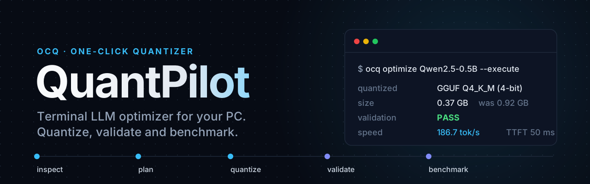

<p align="center">
  
</p>

# QuantPilot (OCQ)

**One command line tool to answer:** *Will this model run on my PC? How should I quantize it? Did the quant job actually work?*

You give QuantPilot either:

- a **Hugging Face model id** (`Qwen/Qwen2.5-7B-Instruct`), or  
- a **folder on disk** with your own fine-tuned weights (Unsloth, Axolotl, PyTorch Trainer, TRL, etc.)

It inspects **your hardware**, estimates **memory and speed** from the model’s real **`config.json` + safetensors shapes**, picks or accepts a **quantization backend**, runs the job, **validates** the output, and **benchmarks** it.

Every fact about the model is read from its files and labelled with **where it came from** and **how sure it is**. Nothing is guessed from the model’s name.

Install the CLI as **`ocq`**.

---

## What you get in one run

```
Your PC + model  →  feasibility table  →  plan  →  quantize  →  validate  →  benchmark
```

| Step | Command | What it does |
|------|---------|----------------|
| 1 | `ocq profile` | CPU, RAM, GPU, bandwidth, free disk |
| 2 | `ocq backends` | Which backends are installed on this machine |
| 3 | `ocq inspect <model>` | What QuantPilot knows about the model: every fact, its source, how sure it is |
| 4 | `ocq feasibility <model>` | Table: original weights + GGUF + AWQ + GPTQ + BNB (+ NVFP4 on NVIDIA) — fit and speed |
| 5 | `ocq plan <model>` | What would run (dry run, no download) |
| 6 | `ocq optimize <model> --execute` | Quantize, check artifact, measure tok/s and time-to-first-token |

`optimize` defaults to **dry run**. Add **`--execute`** to really quantize.

---

## Install

You need [uv](https://docs.astral.sh/uv/) and Python 3.10+.

```sh
cd quantPilot
uv sync --group dev
```

| What you want | Install |
|---------------|---------|
| Look up fit / plan only (no quant) | `uv sync --group dev` |
| Quantize to **GGUF** (llama.cpp / Ollama) | `uv sync --group dev --extra gguf` |
| Quantize to **AWQ** | `uv sync --group dev --extra awq` |
| Quantize to **GPTQ** | `uv sync --group dev --extra gptq` |
| Quantize to **bitsandbytes** | `uv sync --group dev --extra bnb` |
| Quantize to **NVFP4** | `uv sync --group dev --extra nvfp4` |
| Everything | `uv sync --group dev --all-extras` |

Extras pull in **PyTorch** (large download). On **Windows**, CUDA PyTorch is used when you have an NVIDIA GPU.

**Tips**

- Project on OneDrive? Put the venv elsewhere:  
  ` $env:UV_PROJECT_ENVIRONMENT = "$HOME\.venvs\quantpilot" ` (PowerShell)
- **Linux + GGUF:** `sudo apt install libgomp1` if llama.cpp complains about OpenMP.

**2-minute smoke test (Hub model, GGUF):**

```sh
uv sync --group dev --extra gguf
uv run ocq optimize HuggingFaceTB/SmolLM2-135M-Instruct -b gguf --gguf-type Q4_K_M --execute
```

---

## Path A — Hugging Face model

```sh
# What is this model? (reads config.json and safetensors headers, no weights)
uv run ocq inspect Qwen/Qwen2.5-7B-Instruct

# Will it fit? (downloads metadata only, not full weights)
uv run ocq feasibility Qwen/Qwen2.5-7B-Instruct

# Pick backend yourself
uv run ocq optimize Qwen/Qwen2.5-0.5B-Instruct -b gguf --gguf-type Q4_K_M --execute
uv run ocq optimize Qwen/Qwen2.5-0.5B-Instruct -b awq --execute
uv run ocq optimize Qwen/Qwen2.5-0.5B-Instruct -b gptq --bits 4 --execute
uv run ocq optimize Qwen/Qwen2.5-0.5B-Instruct -b bnb --bits 4 --execute
```

Gated models (Llama, Gemma, …): set **`HF_TOKEN`** or **`HUGGING_FACE_HUB_TOKEN`**.

**GGUF files work too**, from a repo that only has GGUFs or from disk. QuantPilot reads one file's header (with range requests, not the weights) and lists **one row per file** in `feasibility`, so you see which one fits:

```sh
uv run ocq feasibility unsloth/Qwen3-30B-A3B-Instruct-2507-GGUF
uv run ocq inspect ./models/Qwen2.5-7B-Instruct-Q4_K_M.gguf     # a file, or a folder of GGUFs
```

The tensor table is checked against the file size, and the context memory computed from a GGUF header matches llama.cpp's own log (Gemma 2/3, LFM2, Granite 4.0-H, Falcon-H1, Jamba).

**Already-quantized repos** (GPTQ, AWQ, bitsandbytes, FP8, W8A8, NVFP4, MXFP4) are recognised. `feasibility` shows them as stored, and `plan` / `optimize` refuse to quantize them again, since that would stack the rounding errors. They point you to the original instead:

```
Error: Qwen/Qwen2.5-1.5B-Instruct-GPTQ-Int4 is already quantized (GPTQ 4-bit). Quantizing it
again would stack the rounding errors; quantize the original instead: ocq optimize
Qwen/Qwen2.5-1.5B-Instruct
```

Optional: `ocq recommend` suggests models from the [llmfit](https://github.com/AlexsJones/llmfit) catalog when available.

---

## Path B — Your own model (fine-tune on disk)

Use this when you trained or merged a model locally and **did not** upload it to the Hub.

### 1. Export a full checkpoint folder

OCQ needs a standard **Hugging Face `save_pretrained` layout**, not LoRA adapters alone.

| You trained with | Save like this |
|------------------|----------------|
| **Unsloth** | `model.save_pretrained_merged("my-model", tokenizer, save_method="safetensors")` |
| **Axolotl** | Merged weights in `output_dir`, or `model.save_pretrained(path, safe_serialization=True)` |
| **PyTorch / HF Trainer / TRL** | `model.save_pretrained("./my-model", safe_serialization=True)` + save tokenizer |

**Folder must contain:**

| File | Why |
|------|-----|
| `config.json` | Layers, heads, context — used for KV cache size |
| `*.safetensors` | Weight shapes and dtypes (headers only for sizing; full files for quant) |
| Tokenizer files | Required for conversion and benchmarks |

**Not supported:** adapter-only LoRA folders, `.bin`-only weights (re-save with `safe_serialization=True`).

### 2. Run the same commands as Hub — but pass the folder

```sh
# Path as argument
uv run ocq feasibility ./my-model
uv run ocq plan ./my-model -b gguf --gguf-type Q4_K_M

# Or explicit flag (easier on Windows)
uv run ocq feasibility -m C:\Users\you\models\my-model
uv run ocq optimize -m C:\Users\you\models\my-model -b gguf --gguf-type Q4_K_M --execute
```

**Any backend works** on a local folder — same as Hub:

```sh
uv run ocq optimize ./my-model -b awq --execute
uv run ocq optimize ./my-model -b gptq --bits 4 --execute
uv run ocq optimize ./my-model -b bnb --bits 4 --execute
uv run ocq optimize ./my-model -b gguf --gguf-type Q4_K_M --execute
```

Nothing is uploaded. **`feasibility`** reads **your** safetensors + config and shows one row per format (original, each GGUF level, AWQ, GPTQ, BNB).

---

## Choosing a backend

| Backend | `-b` | Bits | Best for | Runs with |
|---------|------|------|----------|-----------|
| **GGUF** | `gguf` | 2–8 (`--gguf-type`) | CPU, Windows, Ollama, llama.cpp | Ollama, LM Studio, llama.cpp |
| **AWQ** | `awq` | 4 | NVIDIA GPU serving | vLLM, transformers |
| **GPTQ** | `gptq` | 4, 8 | NVIDIA GPU (CPU calib = slow) | vLLM, transformers |
| **BNB** | `bnb` | 4 (default), 8 | Quick 4/8-bit HF load | transformers |
| **NVFP4** | `nvfp4` | 4 | NVIDIA Blackwell GPUs (RTX 50xx, B200, GB10…) | vLLM |

**Auto-pick** (when you omit `-b`):

- **Linux + NVIDIA Blackwell + enough RAM** for calibration → NVFP4 (4-bit)  
- **Linux + other NVIDIA + enough RAM** for calibration → AWQ or GPTQ  
- **Everything else** (including **Windows + NVIDIA**) → GGUF. vLLM, which serves AWQ, GPTQ and NVFP4, does not run natively on Windows; in WSL2 QuantPilot sees Linux. Forcing `-b awq` on Windows gives a warning.  

GGUF downloads **llama.cpp** automatically on first use (`~/.cache/ocq/llama.cpp`). Conversion uses the checkpoint’s real dtype (**f32 / bf16 / f16**), then quantizes.

---

## Reading `inspect`

`inspect` prints what QuantPilot knows about a model before it sizes anything:

```
Parameters      cross-checked  1,543,714,304
                               from safetensors headers + HF API + base model
                               926 tensors, packed weights unpacked, scales left out
                               (409,317,376 stored values); matches HF API total; matches base
                               model Qwen/Qwen2.5-1.5B-Instruct
Stored bytes    exact          1,149,760,512
                               from safetensors headers
Quantization    cross-checked  GPTQ 4-bit
                               from config.json quantization_config + tensor names
```

| Kind | Meaning |
|------|---------|
| **exact** | Read from one of the model's files |
| **cross-checked** | Read from two sources that agree (for example the tensor headers and the Hugging Face API) |
| **estimate** | Worked out by QuantPilot, or the sources disagree (the note says how) |
| **unknown** | Not in the files. QuantPilot says so instead of guessing |

The facts: parameter count, precision, stored size, architecture, context length, context memory per token, **weights used per token** (less than all of them for mixture-of-experts models) and whether the model is already quantized.

For quantized repos the Hugging Face API count can be wrong (it counts bitsandbytes scales as weights and does not unpack NVFP4), so the count is also checked against the **base model** the repo names. A model with no readable count gets **no fit verdict**, instead of a guess.

---

## Reading `feasibility`

The table has one row per **format**, not just GGUF:

1. **Original** — model as saved (F32 / BF16 / F16 from safetensors)  
2. **GGUF** — Q8_0, Q6_K, Q5_K_M, Q4_K_M, Q3_K_M, Q2_K  
3. **AWQ / GPTQ / BNB** — packed size from the same tensor list, scales included. BNB 4-bit gets two rows, **single** and **double** quantization (see below)  
4. **NVFP4** — only shown when the PC has an NVIDIA GPU  

Columns: weight GB, context GB (from `--context`, default 4096, and `--kv-cache`), total need, **fit**, **runs on** (`gpu`, `2 gpus`, `gpu+ram`, `gpu+ram (experts)`, `cpu`, `unfit`), **tok/s**.

An already-quantized repo gets a single row, the files as stored.

**Speed symbols**

| Symbol | Meaning |
|--------|---------|
| `~ N` | Expected speed from **past GGUF benchmarks on this PC** |
| `<= N` | Theoretical max from memory bandwidth (common for AWQ/GPTQ/BNB rows) |

After **`optimize --execute`**, you get **measured** tok/s and time-to-first-token in the terminal.

**Exact vs estimated:** If OCQ can read safetensors headers and `config.json`, sizes are **exact**. Without the headers it falls back to the parameter count from the Hugging Face API and labels the sizes **estimated**. When the context memory cannot be worked out (neither `config.json` nor the tensor names show the attention layout), the Context column shows **`?`** and no row is rated better than **Marginal**.

---

## Useful options (`plan` and `optimize`)

| Option | Purpose |
|--------|---------|
| `-g`, `--goal` | `balanced` (default), `speed`, `quality`, `memory` |
| `-b`, `--backend` | `gguf`, `awq`, `gptq`, `bnb`, `nvfp4` |
| `--bits` | 4 or 8 where the backend allows |
| `--gguf-type` | e.g. `Q4_K_M`, `Q5_K_M`, `Q8_0` (full list in `ocq plan --help`) |
| `-m`, `--model-path` | Local folder instead of Hub id |
| `-c`, `--context` | Context length for KV cache math and GGUF bench (default 4096). Also on `feasibility` |
| `--kv-cache` | Context cache type: `f16` (default), `q8_0`, `q4_0`. See [Context memory](#context-memory-and---kv-cache). Also on `feasibility` |
| `-o`, `--output` | Output dir (default `./ocq-output/<model>`) |
| `--samples`, `--seq-len` | AWQ/GPTQ calibration size |
| `--double-quant` / `--single-quant` | BNB 4-bit: quantize the scales too, or not (default: double, single for `--goal speed`). Implies `-b bnb --bits 4` |
| `--fp4-activations` / `--fp4-weights-only` | NVFP4: FP4 activations too, or weights only (default: activations on Blackwell). Implies `-b nvfp4` |
| `--dry-run` / `--execute` | Plan only vs run quant (default: dry run) |

---

## Double quantization

Quantized weights need **scales** to turn the small integers back into real numbers, and those scales take memory too. *Double quantization* quantizes the scales themselves.

| Format | Scales | Extra bits per weight |
|--------|--------|-----------------------|
| **BNB 4-bit single** | one 32-bit scale per 64 weights | 0.5 |
| **BNB 4-bit double** | 8-bit scale per 64 weights, one 32-bit scale per 256 of those | ~0.127 |
| **GGUF K-quants** (Q2_K–Q6_K) | built in: 16-bit scale per 256 weights, sub-block scales in 4–8 bits | always on |
| **GGUF Q4_0 / Q5_0 / Q8_0** | one 16-bit scale per 32 weights | 0.5 |
| **NVFP4** | 8-bit (FP8) scale per 16 weights, one 32-bit scale per tensor | always on (~0.5) |
| **AWQ / GPTQ** | one 16-bit scale (+ zero point) per group, 128 by default | not available |
| **BNB 8-bit** | one 32-bit scale per row | not available (already ~0) |

Double quantization saves about **0.37 bits per weight**: roughly 300 MB on a 7B model, about 3 GB on a 70B model, with almost no quality loss. The cost is a slightly slower unpack. Only **bitsandbytes 4-bit** makes it a choice:

```sh
uv run ocq optimize ./my-model -b bnb --bits 4 --execute   # double (default)
uv run ocq optimize ./my-model --single-quant --execute    # single
```

`plan` tells you how much it saves on your model. Sizes are checked against real bitsandbytes 0.50 artifacts.

---

## NVFP4 and your GPU

NVFP4 stores weights as 4-bit floats with two levels of scales. QuantPilot reads your GPU's compute capability from `nvidia-smi` (or its name, on old drivers) and adapts:

| Your GPU | What you get |
|----------|--------------|
| **Blackwell** (compute capability 10+: RTX 50xx, RTX PRO Blackwell, B200, GB10…) | Picked automatically for 4-bit on Linux. Weights **and activations** in FP4, so the FP4 tensor cores do the math. Calibrated. |
| **Other NVIDIA** (H100, RTX 40xx, …) | Available with `-b nvfp4`, weights only. vLLM runs it through its Marlin kernel at about AWQ speed, so AWQ stays the default. |
| **No NVIDIA GPU** (Mac, CPU) | Row hidden in `feasibility`. `-b nvfp4` still quantizes (on the CPU, also on Apple Silicon), to serve on another machine. |

Quantizing here to serve on a Blackwell server? Add `--fp4-activations`.

---

## Context memory and `--kv-cache`

Besides the weights, a model keeps a **key and a value for every token of context**, in every attention layer. QuantPilot reads how each layer does this from `config.json` and checks the total against the tensor shapes:

| Layer kind | Models | What it keeps |
|------------|--------|---------------|
| **Full attention** | most models | every token |
| **Sliding window** | Gemma 2/3, gpt-oss, Cohere2 | only the last *window* tokens (Gemma 3: 512) |
| **Chunked** | Llama 4 | one 8,192-token chunk |
| **MLA** | DeepSeek V2/V3, Kimi | one small compressed vector per token (transformers expands it to full keys and values) |
| **No cache** | Mamba, linear-attention and convolution layers of hybrids (Granite 4.0-H, Nemotron-H, Jamba, LFM2, Qwen3-Next) | a fixed-size state per conversation (counted for Mamba and convolution layers, matching llama.cpp; not yet for linear attention) |

Sliding-window sizes follow llama.cpp, checked against its own logs: a sliding layer keeps *window × conversations + 512* tokens. QuantPilot assumes **4 conversations**, `llama-server`'s default. A model with a window on every layer (Mistral 7B v0.1) is counted in full, as llama.cpp keeps it.

**`--kv-cache`** stores the keys and values in fewer bits:

| `--kv-cache` | llama.cpp (GGUF rows) | vLLM (AWQ, GPTQ, NVFP4 rows) | transformers (original, BNB rows) |
|--------------|-----------------------|-------------------------------|-----------------------------------|
| `f16` (default) | 16 bits | 16 bits | 16 bits |
| `q8_0` | 8.5 bits, `-ctk q8_0 -ctv q8_0`, almost no quality loss | 8 bits, `--kv-cache-dtype fp8` (GPUs of compute capability 8.9+: RTX 40xx, H100, RTX 50xx; else 16 bits) | 16 bits |
| `q4_0` | 4.5 bits, `-ctk q4_0 -ctv q4_0`, some quality loss | 8 bits (no 4-bit cache in vLLM) | 16 bits |

```sh
uv run ocq feasibility Qwen/Qwen2.5-32B-Instruct -c 32768 --kv-cache q8_0
```

A quantized V cache needs flash attention; llama.cpp turns it on by itself. The GGUF benchmark runs with the cache you chose, and `plan` prints the flags for your runtime. `inspect` shows the context memory per token and what it adds up to at 4,096 tokens and at the model's longest context.

---

## Several GPUs

QuantPilot uses every GPU in the PC, the way the runtime that serves each format does:

| Runtime | How it uses several GPUs | Memory | Speed limit |
|---------|--------------------------|--------|-------------|
| llama.cpp (GGUF), transformers (BNB, original) | whole layers on each card, the cards take turns | free VRAM adds up (RTX 3090 + 3060 = 35 GB) | a mix of the cards' speeds |
| vLLM (AWQ, GPTQ, NVFP4) | tensor parallel: an equal slice of every layer on each card | N × the smallest card; N must divide the attention heads | N × one card |

A model that fits on the fastest card alone stays there instead of being slowed down by a slower one. `plan` says how the GPUs are used, and gives `--tensor-parallel-size` for vLLM. Two identical cards are no longer counted as one.

---

## Mixture-of-experts models

Models like Qwen3-30B-A3B, Mixtral, DeepSeek and gpt-oss hold many **experts** per layer but run only a few for each token (Qwen3-30B-A3B: 8 of 128). All experts must fit in memory, but each token reads only about 10% of the weights, so the speed limit is set by the **weights used per token**. QuantPilot counts the experts from the tensor names, checks them against `config.json`, and matches the "active parameters" the model cards publish (3.3B for Qwen3-30B-A3B, 12.9B for Mixtral, 3.61B for gpt-oss-20b).

**Too big for your VRAM?** On a PC with a separate GPU, a GGUF mixture of experts can keep the **experts of its first layers in RAM** and everything else (attention, the context) in VRAM: llama.cpp's `--n-cpu-moe N`. A token uses only a few experts, so little is read from the slow RAM. `feasibility` shows such rows as `gpu+ram (experts)`, `plan` gives the smallest `N` that fits, and the benchmark runs with it. Expert sizes match `llama-quantize` exactly (OLMoE, Granite MoE).

---

## After `optimize --execute`

```
ocq-output/<model>/
  artifact/          ← your quantized model (.gguf or HF folder)
  workspace/         ← logs (convert, quantize, benchmark)
  error.log          ← only if something failed
```

Validation checks: file exists, smaller than original, loads, generates readable text. Exit code **non-zero** if validation fails.

- **GGUF** speed: **llama-bench** (3 × 128 tokens), with the `--kv-cache` you chose.  
- **AWQ/GPTQ/BNB/NVFP4** speed: **transformers** generate (sanity check, not vLLM deployment speed).

---

## Check QuantPilot on your PC: `ocq verify`

`verify` loads a local GGUF in llama.cpp once, reads llama.cpp's own memory numbers from its log, and puts them next to QuantPilot's prediction. It exits with an error when they differ beyond llama.cpp's rounding:

```sh
uv run ocq verify ./Qwen3-30B-A3B-Q4_K_M.gguf -c 16384 --kv-cache q8_0
```

```
Memory                       QuantPilot   llama.cpp   Difference
context cache (KV)               544.00      544.00        +0.00   ok
weights on the GPU             2,410.10    2,410.10        +0.00   ok
weights on the CPU (file range) 1,342.57   1,342.57        +0.00   ok
```

By default it runs llama.cpp with QuantPilot's own plan for this PC (for a mixture of experts too big for the VRAM, the `--n-cpu-moe` it predicts), so that plan is what gets checked. On an Apple Silicon Mac it matched exactly for dense, sliding-window, mixture-of-experts, Mamba and convolution hybrids; running it on an NVIDIA PC checks the CUDA side.

---

## How sizing works (short version)

**Memory needed ≈ weights + context**

- **Weights:** tensor names/shapes from safetensors (Hub metadata or local files). GGUF uses llama.cpp’s per-tensor rules; AWQ/GPTQ/BNB use packed linear-layer math plus their scales (single or double quantized for BNB 4-bit).  
- **Context:** KV cache from `config.json` (layers, KV heads, head dim, and the layer kinds above) × `--context` at the `--kv-cache` type, cross-checked with the K and V projection shapes, plus a small output buffer.  
- **Fit:** compared to **free VRAM and RAM right now**, not total installed memory, over every GPU the runtime would use.  
- **Speed:** memory bandwidth ÷ the bytes each token reads: the weights used per token (less for mixture-of-experts models, and only one row of the input embedding table).

**Quantizing needs extra disk/RAM** beyond “running” the model (e.g. full weights on disk for GGUF convert, full model in RAM for AWQ/GPTQ calibration). `plan` warns about this.

Details and hardware telemetry: see inline comments in `src/ocq/model_size.py` and `measurements.py`. Cache data lives under `~/.cache/ocq/`.

---

## All commands

| Command | Description |
|---------|-------------|
| `profile` | This machine: CPU, RAM, GPU, bandwidth, disk |
| `backends` | Installed quant backends and what’s missing |
| `inspect` | Every fact about a model, its source and how sure it is |
| `verify` | Load a GGUF in llama.cpp once and compare its memory with QuantPilot's prediction |
| `recommend` | Suggested Hub models for this PC |
| `feasibility` | Full format table for one model |
| `plan` | Quant plan + warnings (no heavy work) |
| `optimize` | Full pipeline; use `--execute` to quantize |

---

## Development

```sh
uv run pytest              # fast unit tests
uv run pytest -m slow      # real quant on a tiny model, each installed backend
uv run ruff check .
make check                 # ruff + fast tests
```

Size formulas are tested against real files: `tests/tests/data/` holds the `config.json`, safetensors headers (no weights) and Hugging Face counts of real repos, and expected values come from real artifacts and llama.cpp's own logs.

---

## Environment variables

| Variable | Use |
|----------|-----|
| `HF_TOKEN` / `HUGGING_FACE_HUB_TOKEN` | Gated Hub models |
| `OCQ_LLMFIT_BIN` | Custom llmfit binary path |
| `OCQ_LLAMA_CPP_BIN` | Your own `llama-quantize` / `llama-completion` folder |
| `OCQ_LLAMA_CPP` | Your own llama.cpp source with `convert_hf_to_gguf.py` |

---

## Project layout (for contributors)

```
src/ocq/
  cli.py              Commands
  hardware.py         PC detection (llmfit or built-in probe)
  local_model.py      Local save_pretrained folders
  model_analyzer.py   Feasibility tables, Hub + local resolve
  model_size.py       Weight and KV cache byte math
  engine.py / plan.py Backend and bit-width decisions
  pipeline.py         optimize orchestration
  quantizers/         gguf, awq, gptq, bnb, nvfp4 implementations
```

MIT license. CLI entry point: **`ocq`**.
