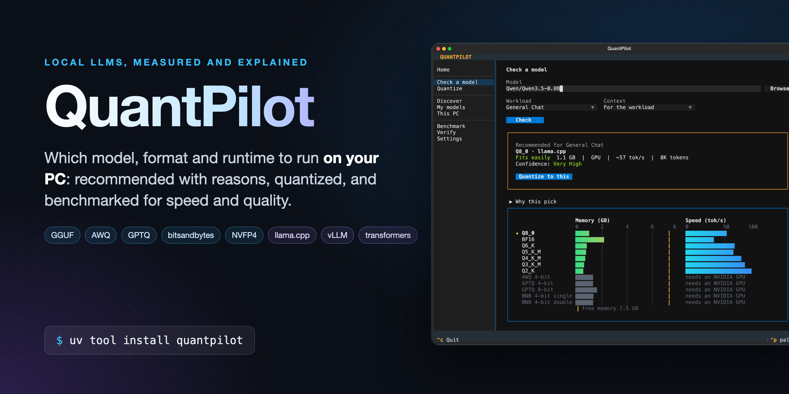
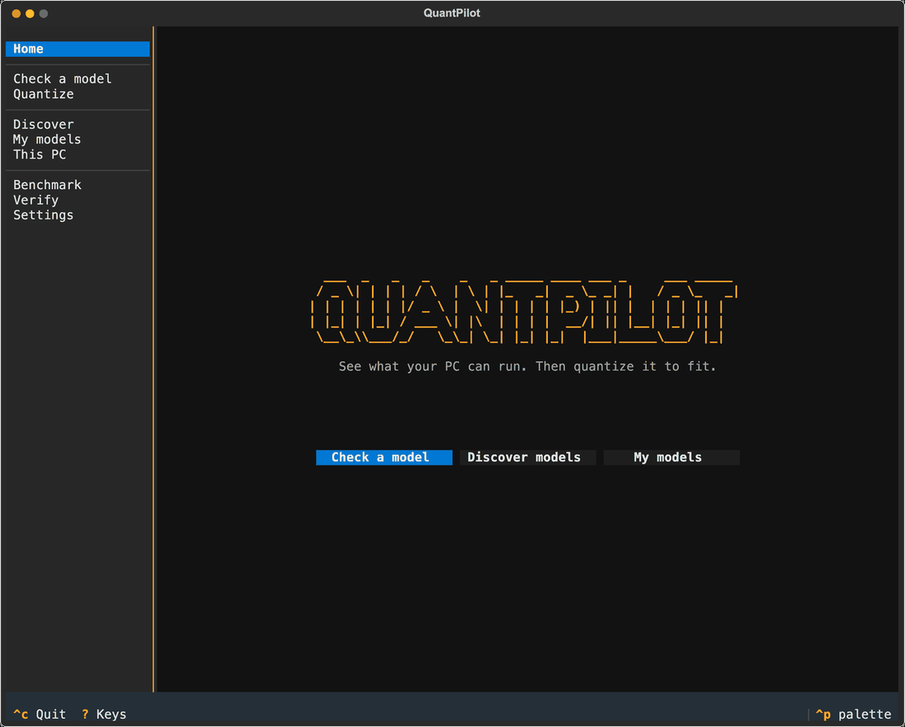
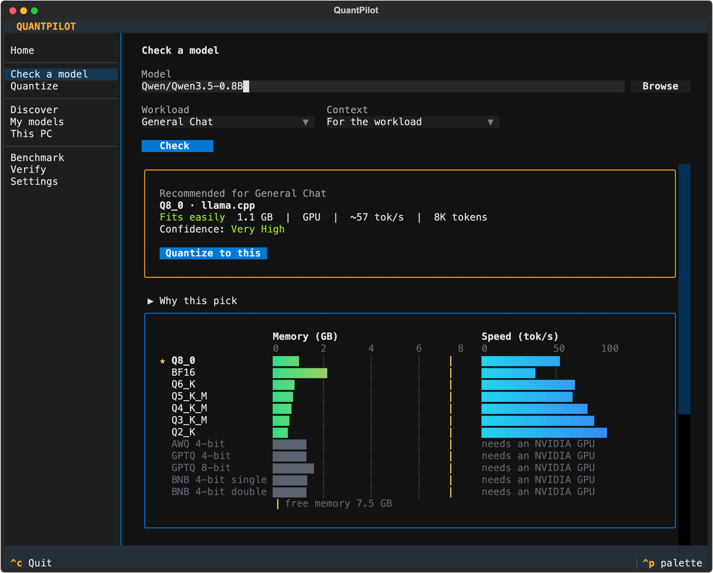
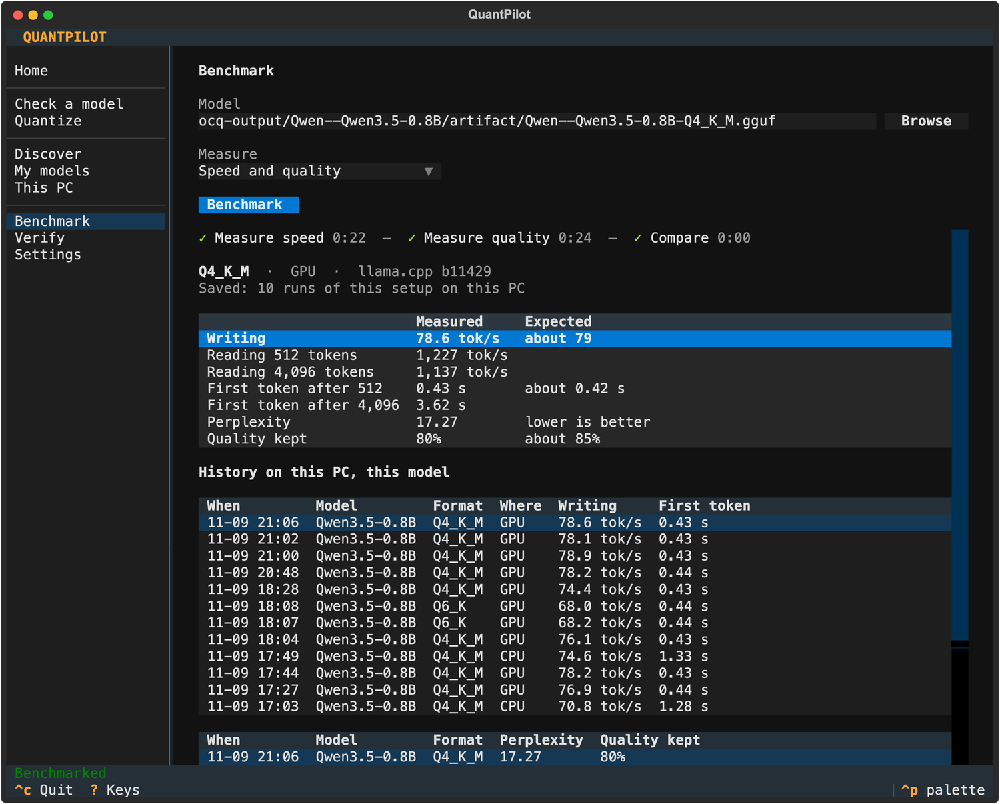

<p align="center">
  
</p>

<p align="center">
  <a href="https://github.com/glastonvelvarts/QuantPilot/actions/workflows/test.yml"></a>
  <a href="https://pypi.org/project/quantpilot/"></a>
  
  
  <a href="https://github.com/glastonvelvarts/QuantPilot/blob/main/LICENSE"></a>
</p>

**QuantPilot** tells you which local LLM to run on your PC, in which format and runtime, and why. It sizes every option from the model's own files, checks it against your free memory, ranks the options for the kind of work you do, and measures speed and quality on your machine instead of guessing. Then it makes the file for you.

<p align="center">
  
</p>

- **Recommends** the model, format (GGUF, AWQ, GPTQ, bitsandbytes, NVFP4), runtime (llama.cpp, vLLM, transformers) and context cache for chat, coding, RAG, agents, reasoning, long context, low latency or throughput, with the reasons and how sure it is.
- **Sizes exactly**: weights and context memory from `config.json` and the tensor headers (no download of the weights), checked against llama.cpp's own memory numbers on NVIDIA, Apple Silicon and CPU.
- **Measures**: speed and time to the first token with llama.cpp's benchmark, and quality as perplexity on WikiText-2, compared with the original model. Every result is kept, and the recommendations learn from it.
- **Quantizes**: one command (or one button) from a Hugging Face model or your own fine-tune to a checked, benchmarked file.

## Install

QuantPilot runs with [uv](https://docs.astral.sh/uv/getting-started/installation/) on Linux, macOS and Windows, Python 3.10 or newer.

```sh
uv tool install quantpilot          # the ocq and quantpilot commands
uvx quantpilot                      # or try it without installing
```

### Open the app

Type `ocq` in a terminal: with no command it opens the full-screen app (arrow keys and Enter, no flags to remember). `quantpilot` and `ocq tui` do the same, and `ocq --help` lists the commands.

| You installed it with | Open the app |
|---|---|
| `uv tool install quantpilot` | `ocq` (or `quantpilot`) |
| nothing: just try it | `uvx quantpilot` |
| `pip install quantpilot` in a virtual environment | `ocq`, with that environment active |
| a clone of this repo (`uv sync`) | `uv run ocq` |

### Quantization formats

Each quantization format is an extra, installed when you want it (they bring PyTorch, a large download):

```sh
uv tool install "quantpilot[gguf]"                              # GGUF: any PC
uv tool install "quantpilot[gguf,awq,bnb]" --torch-backend auto # NVIDIA: PyTorch for your driver
```

| Extra | Makes | Needs |
|---|---|---|
| `gguf` | GGUF for llama.cpp, Ollama, LM Studio (2 to 8 bit) | any PC; llama.cpp is downloaded on first use |
| `awq`, `gptq` | AWQ and GPTQ for vLLM | an NVIDIA GPU, Linux or WSL2 |
| `bnb` | bitsandbytes 4 and 8 bit for transformers | an NVIDIA GPU |
| `nvfp4` | NVFP4 for vLLM | an NVIDIA GPU (Blackwell computes it in FP4) |

`ocq doctor` then says what is ready on your PC and gives the command for anything that is not. The app's **This PC** page installs the extras with a button. With pip: `pip install "quantpilot[gguf]"`. From a clone of the repo: `uv sync --extra gguf`.

## Quick start

```sh
ocq                                   # the full-screen app (uv run ocq in a clone of the repo)
ocq doctor                            # is everything ready on this PC?
ocq recommend --workload coding       # which model and format to run, and why
ocq feasibility Qwen/Qwen3-8B         # every format of one model on this PC
ocq optimize Qwen/Qwen3-8B -b gguf --gguf-type Q4_K_M --execute
ocq bench ocq-output/Qwen--Qwen3-8B/artifact/Qwen--Qwen3-8B-Q4_K_M.gguf --quality
```

A model is a Hugging Face id, a folder of your own fine-tune (saved with `save_pretrained`), a `.gguf` file, or an Ollama model (`ollama:qwen3:8b`). `ocq models` lists the ones already on your PC: Ollama, LM Studio, the Hugging Face cache, your folders.

## The app

Run `ocq` for the full-screen app. **Check a model** gives the pick with its reasons and confidence, and every format's memory, speed and quality side by side. **Quantize** makes it with live progress. **Benchmark** measures any model on the PC and keeps the history. **Discover** ranks models for a kind of work, **Settings** keeps a Hugging Face token for gated models.

<p align="center">
  
  
</p>

## How it decides

| | Until measured | Once measured on your PC |
|---|---|---|
| **Memory** | Weights and context from the model's files, as each runtime allocates them (llama.cpp, vLLM, transformers), against your free VRAM and RAM | `ocq verify` compares it with llama.cpp's own numbers |
| **Speed** | The upper bound your memory bandwidth allows | Learnt from your runs: every quantize and benchmark adds one |
| **Time to first token** | Not known: said so | Learnt from your runs, by model size |
| **Quality** | llama.cpp's published loss of each format | Perplexity on WikiText-2 against the original model |

Options that cannot run here are ruled out with the reason. The rest are ranked by the workload's priorities in order (coding: quality, then context, then speed), never by one blended score. Each pick says why it won, what the next options would give and cost, and how sure it is (Low to Very High) with the evidence.

## Formats and where they run

| Format | Runs with | Good for |
|---|---|---|
| **GGUF** (Q2_K to Q8_0) | llama.cpp, Ollama, LM Studio | any PC: CPU, Apple Silicon, NVIDIA, Windows; mixture-of-experts models with experts in RAM |
| **AWQ**, **GPTQ** | vLLM, transformers | serving on an NVIDIA GPU (Linux or WSL2) |
| **bitsandbytes** | transformers | a quick 4 or 8 bit load on an NVIDIA GPU |
| **NVFP4** | vLLM | NVIDIA Blackwell (RTX 50xx, B200, GB10) |
| **MLX** (read, not made) | mlx-lm, LM Studio | Apple Silicon |

Checked against llama.cpp's own numbers on Windows 11 with an RTX 4060 Laptop, Linux (WSL2) with NVIDIA and CPU only, and macOS on Apple Silicon, with GPU and CPU only.

## Commands

| Command | |
|---|---|
| `ocq` | The full-screen app |
| `doctor` | What is ready on this PC, and the command that fixes what is not |
| `recommend` | Model, format, runtime and cache type for a kind of work, with reasons and confidence |
| `models` | The models already on this PC and how each one fits |
| `inspect` | Every fact about a model, where it came from and how sure it is |
| `feasibility` | Every format of one model on this PC |
| `plan`, `optimize` | What would be made, then `--execute` to make it, check it and benchmark it |
| `bench` | Speed and time to the first token; `--quality`: perplexity and quality kept |
| `verify` | Load a GGUF in llama.cpp once and compare its memory with QuantPilot's prediction |
| `history` | This PC's saved benchmarks |
| `profile`, `backends` | This PC's hardware, and the quantization tools installed |

## For scripts and agents

`recommend`, `bench`, `models`, `inspect`, `feasibility`, `profile`, `history` and `doctor` take `--json`, and Python gets the same data:

```python
from ocq import api

pick = api.recommend(workload="coding")["best"]
print(pick["model"]["id"], pick["format"]["label"], pick["quality"]["kept"])
```

The shape is versioned and only grows within a version: see [docs/api.md](https://github.com/glastonvelvarts/QuantPilot/blob/main/docs/api.md).

## Learn more

- [User guide](https://github.com/glastonvelvarts/QuantPilot/blob/main/docs/guide.md): every command and option, how memory, speed and quality are worked out, fine-tunes on disk, GPUs, mixture of experts, environment variables
- [JSON and Python API](https://github.com/glastonvelvarts/QuantPilot/blob/main/docs/api.md)
- [Contributing](https://github.com/glastonvelvarts/QuantPilot/blob/main/CONTRIBUTING.md) and [changelog](https://github.com/glastonvelvarts/QuantPilot/blob/main/CHANGELOG.md)

MIT license.
